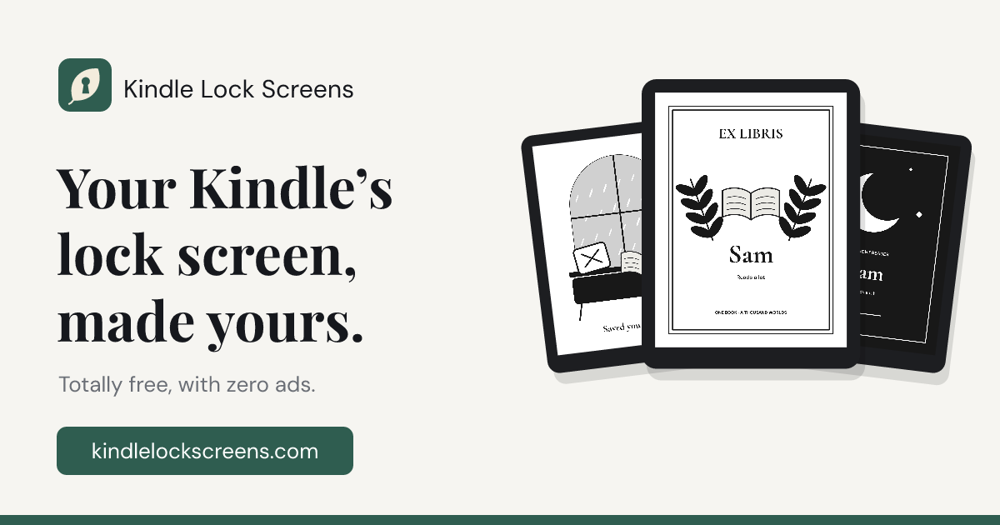

<p align="center">
  <a href="https://kindlelockscreens.com"></a>
</p>

# Kindle Lock Screens

**Free lock screens for your Kindle, Kobo or KOReader.** Turn a favourite photo or one of the hand-drawn designs
into a lock screen, right in your browser. Live at **[kindlelockscreens.com](https://kindlelockscreens.com)**.

A free utility: no ads, no tracking, no accounts, and open source.

## How it works

Kindles don't have a setting for choosing your own lock screen picture, but they can show the cover of the book you
opened last (**Display Cover**). So the site makes a tiny one-page book whose cover is your picture.

1. Pick your e-reader, then a design or a photo (JPG, PNG, WebP or iPhone HEIC).
2. Adjust it: grayscale, brightness, contrast, e-ink sharpening, dithering to 16 greys, and a line of text on photos.
   Designs are drawn on a 1264 × 1680 canvas and scaled to your screen's exact size (600 × 800 up to 1860 × 2480).
3. Download the `.epub` and send it with Amazon's Send to Kindle.
4. Open it once on your Kindle and turn on Display Cover.

For **Kobo**, **KOReader** and jailbroken Kindles you get a PNG at your screen's size instead, or a ZIP of every
design for a screensaver folder. Step-by-step setup: [kindlelockscreens.com/guides](https://kindlelockscreens.com/guides/).

**Your photos never leave your device.** The picture and the book are both made in your browser. The only server
code is an optional counter (`counter/`) that keeps two plain totals, visits and lock screens made, and nothing
about visitors.

It works on Kindle e-readers with the Display Cover setting (recent Paperwhite, Oasis, Scribe, Colorsoft and the
standard Kindle), and only on Kindles without lock screen ads. It does not work on Fire tablets or the Kindle phone
app.

## What's in here

It's a plain static website: HTML, CSS and JavaScript, with no build step, no framework and no third-party scripts.

| Path | What it is |
| --- | --- |
| `public/` | The whole website. |
| `public/src/templates.js` | The designs, each drawn in code. |
| `public/src/catalog.js` | Which designs are on show: seasonal sets appear between their dates. |
| `public/src/app.js` | The maker: photo editing, design text, exports. |
| `public/src/devices.js` | E-readers and their screen sizes. |
| `public/src/filters.js` | Photo filters tuned for e-ink. |
| `public/src/epub.js` | Writes the one-page EPUB (and the ZIP of every design). |
| `counter/` | Optional visit / lock-screens-made counter, no dependencies (`node counter/server.js`). |
| `deploy/Caddyfile` | Example web server config with the security headers the site expects. |

## Run it yourself

Serve the `public/` folder with any web server, for example:

```sh
npx serve public
# or
python3 -m http.server --directory public
```

## Contributing

Bug reports and ideas are welcome: please open an issue. For anything else, email
[hello@kindlelockscreens.com](mailto:hello@kindlelockscreens.com).

## Licence

Everything here, the code and the lock screen designs, is released under the [MIT licence](LICENSE).

Bundled third-party code keeps its own licence: fonts in `public/fonts/` (SIL Open Font License, `OFL.txt`) and
[heic-to](https://github.com/hoppergee/heic-to) in `public/vendor/heic-to/` (LGPL-3.0).

Kindle is a trademark of Amazon.com, Inc. or its affiliates. Kindle Lock Screens is an independent project and is
not affiliated with or endorsed by Amazon.

<p align="center"><sub>Made by nbsf labs.</sub></p>
